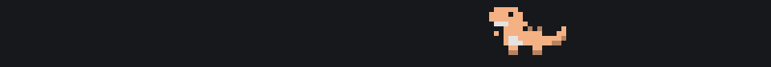
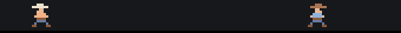

# omarchy-bar-toys

Three small, silly widgets for the [Omarchy](https://omarchy.org/) bar.

| Widget | What it does |
|---|---|
| **bar-pet** | A pixel T-rex that stomps back and forth, sits, naps (with floating z's), and hops when you click it. |
| **showdown** | Two pixel cowboys stand back to back, pace apart, turn, and draw. The winner is random; you see the muzzle flash and the bullet cross the bar, and a running score is kept. Sometimes a tumbleweed rolls through the street during the stare-down. |
| **github-ticker** | A sports-ticker style scroll of recent GitHub activity on your repos: pushes (with commit messages), PRs, issues, comments, stars, forks, releases. Also watches GitHub Actions: a red **FAIL** leads the ticker (with a desktop notification) when a workflow's latest run fails, and a green **FIXED** shows when it passes again. Hover to pause, click a headline to open it. |





The pet and the left cowboy's vest use your theme's accent color, so they recolor with your Omarchy theme.

## Install

```bash
git clone https://github.com/cadens99/omarchy-bar-toys.git
cd omarchy-bar-toys

# copy whichever widgets you want
cp -r bar-pet showdown github-ticker ~/.config/omarchy/plugins/

# add them to the bar
omarchy plugin enable cxdog.bar-pet --section left
omarchy plugin enable cxdog.showdown --section left
omarchy plugin enable cxdog.github-ticker --section right

omarchy restart shell
```

Remove one with `omarchy plugin disable <id>`.

### github-ticker requirements

- The [GitHub CLI](https://cli.github.com/) (`gh`), logged in: `gh auth login`
- `python3`

The ticker never stores or reads a token itself. It runs `fetch.py`, which calls `gh api` using
your existing `gh` login, every few minutes. It shows your own activity plus other people's
activity on your most recently pushed repos. Commit messages and PR titles it has to look up are
cached in `~/.cache/github-ticker/`.

**CI alerts:** for your recently pushed repos (and repos you've been active in), the ticker checks
the latest completed run of each workflow on each branch from the last 3 days. Failures show as a
red `FAIL` (your theme's red) and are pinned to the front for 48 hours; a workflow that passes
right after failing shows a green `FIXED`. Passing runs are not shown. New failures also pop up a
desktop notification once; the first run only records failures that already exist, so you don't
get a burst of old alerts.

Note: if you have private repos, their names and PR titles will scroll across your bar. Keep that
in mind before screen sharing.

## Settings

Add these keys to the widget's entry in `~/.config/omarchy/shell.json`, e.g.
`{ "id": "cxdog.github-ticker", "width": 700 }`, or use `omarchy bar set <id> <key> <value> --json`.

| Widget | Key | Default | Meaning |
|---|---|---|---|
| bar-pet | `trackWidth` | 260 | Pixels of bar the pet can roam |
| showdown | `trackWidth` | 300 | Width of the street |
| showdown | `tumbleweedChance` | 0.4 | Chance (0 to 1) a tumbleweed rolls through each stare-down |
| github-ticker | `width` | 520 | Ticker width in pixels |
| github-ticker | `speed` | 30 | Scroll speed, pixels per second |
| github-ticker | `refreshMinutes` | 5 | How often to poll GitHub |
| bar-pet, showdown | `followReduceMotion` | false | Set `true` to freeze when Omarchy animations are off |

The pet and the cowboys keep moving even when Hyprland animations are turned off (Omarchy does this
on machines without GPU acceleration), since moving is the whole point. They are very cheap: one
small item moved a pixel at a time, about 22 times a second.

## Tinkering

The sprites are plain strings of characters in the QML files, one character per pixel. Edit the
rows near the top of `bar-pet/Pet.qml` or `showdown/Showdown.qml` to redraw them, then run
`omarchy restart shell` (saving alone does not always pick up changes).

## License

MIT
